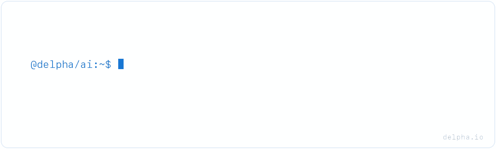

# Delpha AI

Verify commercial identity before your AI agent acts: which company a record refers to,
the commercial group it belongs to, and its business contact details.

This repository holds the Delpha [agent skills](skills/) and the [plugins](providers/) for Claude Code,
Codex and Cursor that bundle them with the [Delpha MCP server](https://help.delpha.io/delpha-api-and-mcp/mcp).
Results include verification findings, confidence and available evidence; your workflow decides
which findings to apply to your CRM.

## Get started

[Create a Delpha account](https://app.delpha.ai/signup) (new teams receive 100 free Credits),
install the plugin for your client and finish Delpha sign-in. Then ask your agent:

```text
Who is the commercial parent of Sephora Brazil (https://www.sephora.com.br)?
```

### Claude Code

```text
/plugin marketplace add Delpha/ai
/plugin install delpha@delpha
```

Then run `/mcp` and sign in. The Claude Code plugin also adds two commands,
`/delpha:verify-company` and `/delpha:verify-contact`.

### Codex

```sh
codex plugin marketplace add Delpha/ai
codex plugin add delpha@delpha
codex mcp login delpha
```

### Cursor

Add `Delpha/ai` as a marketplace under **Settings → Plugins**, then install `delpha`.

### Any MCP client

Every plugin bundles the same connection: `https://mcp.delpha.ai/mcp`, signed in with Delpha.
To connect without a plugin, see the [connection guides](https://help.delpha.io/delpha-api-and-mcp/mcp),
for example `claude mcp add --transport http delpha https://mcp.delpha.ai/mcp`.
Manage access at [Developer → MCP](https://app.delpha.ai/developer/mcp).

## Skills

| Skill | Purpose |
| --- | --- |
| [delpha](skills/delpha/SKILL.md) | Select tools, supply accepted inputs and interpret results. |
| [delpha-gtm-account-routing](skills/delpha-gtm-account-routing/SKILL.md) | Resolve commercial parents and assess new-logo routing using supplied CRM context. |

Skills-aware clients can also copy the folders in [skills/](skills/).

## MCP tools

| Capability | Submit | Retrieve |
| --- | --- | --- |
| Commercial parent | `findAndValidateUltimateParent` | `getUltimateParentResult` |
| Website | `findAndValidateWebsite` | `getWebsiteResult` |
| Legal identifier | `findAndValidateLegalID` | `getLegalIDResult` |
| LinkedIn company page | `findAndValidateLinkedInCompanyPage` | `getLinkedInCompanyPageResult` |
| Email | `findAndValidateEmail` | `getEmailResult` |
| Phone | `validateAndNormalizePhone` | `getPhoneResult` |
| Person name | `validateAndNormalizeName` | `getNameResult` |
| LinkedIn profile | `findAndValidateLinkedInProfile` | `getLinkedInProfileResult` |

Phone and name validate values you already hold; they do not discover people or numbers.
A submission reserves Credits and returns a `job_id`; the result tool settles or refunds that
reservation without a new charge. Repeating a submission starts another charged job.
Read the [current prices](https://api.delpha.io/v1/pricing); all access methods share
[one balance](https://delpha.ai/pricing).

The tools return findings; they do not write to your CRM. Applying changes requires a separate
integration and authorization for the change.

## REST API

The same verifications are available at `https://api.delpha.io`, with batches, webhooks and
company search. Create a key at [Developer → API keys](https://app.delpha.ai/developer/api-keys)
(test-mode keys return canned results without spending Credits) and read the
[API reference](https://help.delpha.io/delpha-api-and-mcp/api) and the
[REST guidance](skills/delpha/references/rest-api.md).

## Resources

- [Delpha](https://delpha.ai) · [App](https://app.delpha.ai) · [Help centre](https://help.delpha.io)
- [Data sources and privacy](https://help.delpha.io/delpha-api-and-mcp/api/data-sources-and-privacy)
- [Contributing](CONTRIBUTING.md) · [Security](SECURITY.md) · [MIT license](LICENSE)
